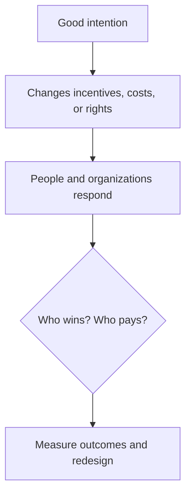
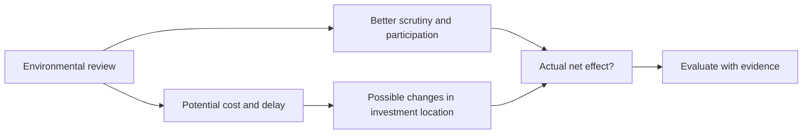

# 🌎 Who Gets the Green? Who Owns the Land?
### An ECON 238 public exhibit on environmental justice, property rights, and unintended consequences

> **The question:** What if a well-intentioned policy improves a place without improving the lives of the people it was designed to protect?

**Week Nine · Fall 2026** | Research-based visual explainer synthesized from written responses and a *planned* discussion guide. **This is not represented as a transcript of a completed recording.**

---

## 🧭 Two stories, one economic puzzle

| **STORY A: “Greenlining”** | **STORY B: Land acknowledgment** |
|---|---|
| Clean air, quieter streets, and safer public space make a neighborhood more desirable. | A university recognizes that Indigenous people were dispossessed. |
| **Who captures rising land values?** Can existing renters stay? | **Who actually controls the land?** Do the named nations gain decision-making power? |

## 🏙️ 1 | Rochester: reclaiming the Inner Loop

Rochester’s proposed **Inner Loop North Transformation** would reconnect downtown with nearby neighborhoods, the Public Market and High Falls, with improved walking routes and green space. The city completed its Mobility and Development Strategy in **December 2025**. The proposal itself is evidence of a serious local environmental-justice question; its promised benefits should not be mistaken for completed outcomes.

*City of Rochester planning diagram, not a photograph of completed construction. [Official source](https://www.cityofrochester.gov/departments/department-environmental-services-des/inner-loop-north-transformation-project).*

**Potential benefit:** Safer access, less separation between neighborhoods, and new public space.

**Potential trade-off:** Neighborhood improvements could increase rents and property prices. Existing owners might gain wealth while current renters struggle to stay.

**Better evaluation:** Measure pedestrian safety, resident retention, housing affordability, traffic noise, and whether residents influenced planning.

## 🔉 2 | What does quiet cost?

A study by **Enrico Moretti and Harrison Wheeler** estimates that home prices within **100 meters** of new sound barriers rise an average **6.8%**. It estimates a **$110 billion capitalized** nationwide traffic-noise burden. That figure is a *present value*, **not** an annual expense.

For scale, treating $110 billion as a perpetual present value at a hypothetical **3% discount rate** would mean approximately **$3.3 billion per year**; a finite horizon gives a different number.

The study also proposes a **$974 lifetime per-vehicle** Pigouvian charge equivalent, not $974 annually. [NBER paper](https://www.nber.org/papers/w34298).

> **Think:** If a sound wall raises property values, does it achieve environmental justice when absentee landlords benefit and renters face rent increases?

## 🏛️ 3 | Can environmental review push investment away?

Massachusetts’ EJ rules promote public participation and additional review near some designated communities. The trade-off: review time and uncertainty may sometimes affect where firms, housing developers, and energy providers place investments.

**Important 2026 correction:** Starting **January 30, 2026**, Massachusetts offered a streamlined review option for *qualifying housing*; an Environmental Impact Report is not automatically mandatory for those eligible projects, although EJ outreach protections remain. [Official Massachusetts explanation](https://www.mass.gov/info-details/streamlined-process-for-qualifying-housing-projects).

**Lesson:** Evaluate whether environmental quality improves *and* whether investment, employment, and housing supply move elsewhere.

## 🌿 4 | From words to rights

A **land acknowledgment** can educate and establish relationships, but normally does not change deeds, leases, public budgets, or control of land. The [Native Governance Center](https://nativegov.org/resources/beyond-land-acknowledgment-a-guide/) argues for moving from statements toward action.

| **Symbolism** | **Institutional change** | **Economic change** |
|---|---|---|
| Recognize history | Share meaningful decision rights | Finance tribal priorities |
| Increase awareness | Establish durable partnerships | Support conservation and jobs |

### Two examples of practical authority

**🇨🇦 Sen̓áḵw, Vancouver.** The **Squamish Nation** is developing over **6,000 planned rental homes** in phases on reclaimed land. Indigenous-led land control can enable housing choices, income, and opportunities for members. [Squamish Nation](https://www.squamish.net/partnerships-entities/partnerships/senakw/).

**🏞️ Bears Ears, Utah.** Five tribal nations and federal agencies signed a **2022 cooperative agreement** concerning management of **Bears Ears National Monument**. This is an example of **co-management, not an outright transfer of a national park**. [U.S. Bureau of Land Management](https://www.blm.gov/canyon-country-do/public-room-blm-library/memorandum-understanding/bears-ears-national-monument).

## 🧪 5 | Test the policy, not the slogan

In a **difference-in-differences** design, an economist compares changes in affected and similar unaffected areas *before and after* a policy, while checking whether their pre-policy trends were alike.

**What would count as success?** Cleaner air and less noise; continued access to affordable housing; more genuine civic participation; durable Indigenous decision-making rights; better habitat conditions; and benefits that reach people who were originally disadvantaged.

### 💬 Questions for readers

1. If a neighborhood becomes greener but too expensive for its current renters, who gained?
2. Should the depth of environmental review depend on *measured harm* more than on demographics alone?
3. What is the minimum action that would make a land acknowledgment meaningful?
4. Should tribal nations be able to set entrance prices or close sensitive parts of parks?
5. What evidence would convince you that tribal co-management protects land better—or worse?
6. How would you measure **who actually benefits** five or ten years after a reform?

---

### Read more
- [Rochester Inner Loop North](https://www.cityofrochester.gov/departments/department-environmental-services-des/inner-loop-north-transformation-project)
- [NBER: The Traffic Noise Externality](https://www.nber.org/papers/w34298)
- [Massachusetts Environmental Justice Populations](https://www.mass.gov/info-details/environmental-justice-populations-in-massachusetts)
- [Massachusetts 2026 qualifying-housing review](https://www.mass.gov/info-details/streamlined-process-for-qualifying-housing-projects)
- [BIA: Tribal land fractionation](https://www.bia.gov/bia/ots/dtlc/fractionation)
- [BIA: HEARTH Act leasing](https://www.bia.gov/service/HEARTH-Act)
- [Native Governance Center: Beyond Land Acknowledgment](https://nativegov.org/resources/beyond-land-acknowledgment-a-guide/)
- [Noah Smith, *No, you are not on Indigenous land*](https://www.noahpinion.blog/p/no-you-are-not-on-indigenous-land)
- [Squamish Nation: Sen̓áḵw](https://www.squamish.net/partnerships-entities/partnerships/senakw/)
- [BLM: Bears Ears cooperative agreement](https://www.blm.gov/canyon-country-do/public-room-blm-library/memorandum-understanding/bears-ears-national-monument)

*Created with AI assistance for ECON 238. Hypotheses about potential displacement or redirected investment are not presented as established causal findings. This educational exhibit draws on a draft written analysis and discussion guide; the assignment also requires an actual recorded discussion and transcript.*
